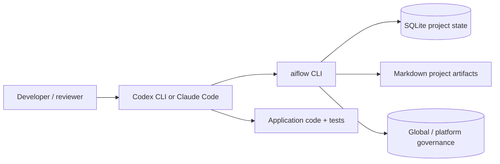
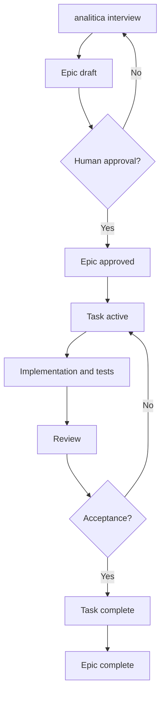

# AIFlow

**Local workflow engine for AI-assisted software development** · Codex CLI / Claude Code · Python 3 · SQLite · Markdown

AIFlow provides a persistent workflow around AI-assisted development: analysis, approved decisions, Epic/Task lifecycle, session tracking, checkpoints, and reports. It is **not** an autonomous CI/CD system or an authorization service.

## 1. System architecture



The agent writes analyses and code. The CLI allocates identifiers and records state transitions. SQLite is the operational record; Markdown is human-readable, versionable documentation.

## 2. Concepts and lifecycle

| Concept | Responsibility | Example |
|---|---|---|
| Epic | Scope, UX, requirements and acceptance criteria for a capability | `EPIC-001` |
| Task | Verifiable development unit inside an Epic | `EPIC-001/TASK-001` |
| Decision | Proposed technical/business choice, requiring explicit approval | Database selection |
| Checkpoint | Durable summary and next action for recovery | `CP-0001` |
| Session | Bounded work period | Session start/stop |
| Approval | Recorded explicit human confirmation | scope, requirements, plan, acceptance |



`analitica` must **stop** after a blocking question; assumptions must remain unapproved. The CLI records supplied approval evidence but does not cryptographically verify the identity of the approver.

## 3. Project structure

```text
project/
├── AGENTS.md
└── .aiflow/
    ├── project.md
    ├── architecture.md
    ├── state/
    │   ├── aiflow.sqlite3
    │   ├── current.md
    │   ├── decisions.md
    │   └── checkpoints.md
    └── epics/EPIC-001/
        ├── epic.md
        ├── analysis.md
        ├── ux.md
        └── tasks/TASK-001/
            ├── task.md
            └── report.md
```

The CLI generates scaffolds. Agents populate substantive analysis, UX, acceptance criteria, implementation notes and test evidence. Additional approval and checkpoint Markdown files are generated as needed.

## 4. Install from GitHub Releases

**Prerequisites:** Python 3, network access, and a published GitHub Release in `alegiac/aiflow` with both `aiflow-release.zip` and `aiflow-release.zip.sha256`.

The repository owner must publish those release assets. **A GitHub repository alone is not sufficient** for the release-based installer.

Download `tools/install_manager.py` from the repository and run:

```bash
python3 install_manager.py install --prefix "$HOME/.local/share/aiflow"
echo 'export PATH="$HOME/.local/share/aiflow/bin:$PATH"' >> ~/.zshrc
source ~/.zshrc
aiflow --help
```

If you already have the repository checked out:

```bash
python3 tools/install_manager.py install --yes
```

Installer behavior: obtains latest GitHub Release via API, downloads the ZIP and `.sha256`, checks the digest, validates archive paths, stages the installation, and retains a `.previous` rollback directory. It does not edit project `.aiflow/` state.

**Important:** the SHA256 file is served by the same release publisher. This detects corrupted/mismatched downloads but is not an independent signature of publisher identity.

### Upgrade

```bash
aiflow check-update
aiflow upgrade
```

After upgrading, in each active project:

```bash
aiflow integrate both
aiflow doctor
```

The CLI updater defaults to `~/.local/share/aiflow`; for a custom installation use `aiflow upgrade --prefix /your/path`. For an existing manually extracted framework, the release installer cannot assume ownership of its directory: install into a new dedicated prefix first, then update your PATH.

## 5. New project quick start

```bash
mkdir -p ~/Development/example && cd ~/Development/example
aiflow init --profile php-laravel
aiflow integrate both
aiflow doctor
codex       # or: claude
```

Ask the agent: `aiflow?` for contextual help or request `analitica` to start requirements analysis.

## Composable technology profiles

Initialize a project with multiple comma-separated technology profiles. Profiles are Markdown guidance that the AI agents apply together; they do not install dependencies or change your application stack.

```bash
aiflow profile available
aiflow init --profile php-laravel,react,shadcn,tailwind,shopify-graphql,mysql
aiflow integrate both
aiflow profile list
```

Add or remove technologies later without reinitializing the project:

```bash
aiflow profile add nodejs,postgresql
aiflow profile remove mysql
aiflow profile sync

# Read the complete rules for a technology
aiflow profile walkthrough php-laravel
aiflow profile walkthrough shopify-graphql
```

The ordered list is stored in `.aiflow/config.json` under `profiles`, with `profile` preserved for compatibility. AIFlow generates `.aiflow/profiles/README.md` as an agent-readable index. The actual versioned guidance lives in the installed AIFlow `profiles/<slug>/PROFILE.md` directory; updating AIFlow can update those definitions. The CLI preserves existing project documents and does not install npm packages, database servers or Shopify apps.

Bundled profiles: `php-laravel`, `react`, `shadcn`, `tailwind`, `shopify-rest` (legacy), `shopify-graphql`, `postgresql`, `mysql`, `nodejs`. REST and GraphQL may coexist during migration; shadcn requires a compatible React/Tailwind setup. Explicitly select multiple databases only if the architecture calls for them.

Every bundled technology has a dedicated Codex/Claude walkthrough skill named `aiflow-profile-<slug>-walkthrough`, installed by `aiflow integrate both`. Invoke it to explain every profile section, discuss practical examples and ask follow-up questions. The CLI walkthrough is read-only and also works outside an initialized project.\n\nFor existing projects initialized with a single `profile` value, `aiflow profile add ...` upgrades the configuration without resetting the SQLite state. Re-run `aiflow integrate both` after upgrading to refresh agent instructions. Profile selection informs agent behavior; it does not automatically validate every cross-stack dependency.

## 6. Example workflow

```bash
aiflow epic create "Gestione note"
aiflow decision propose EPIC-001 "Database SQLite"
aiflow approve EPIC-001 scope --by human --evidence "Review confirmed"
aiflow approve EPIC-001 requirements --by human --evidence "Review confirmed"
aiflow approve EPIC-001 plan --by human --evidence "Review confirmed"
aiflow workflow-epic approve EPIC-001 --by human --evidence "Review confirmed"
aiflow task create EPIC-001 "CRUD note"
aiflow workflow-task start EPIC-001 TASK-001
aiflow session start
aiflow track start --epic EPIC-001 --task TASK-001
aiflow checkpoint EPIC-001/TASK-001 "CRUD implemented" --next "Run tests"
aiflow recover
aiflow track stop
aiflow session stop
aiflow report project
aiflow export tracking.csv
```

### Global and platform decisions

```bash
aiflow decision propose GLOBAL "Prefer SOLID, DRY and KISS"
aiflow decision propose PLATFORM:php-laravel "Use Form Requests for validation"
aiflow decision list
aiflow decision approve 1 --ref GLOBAL --by human --evidence "Architecture review"
```

Shared decisions are stored under `~/.config/aiflow/` (override with `AIFLOW_HOME`). They are **machine-local**, not synchronized automatically through Git. A local decision must not silently override an approved global/platform decision.

## 7. Daily multi-project report

`tools/daily_digest.py` scans `.aiflow/state/aiflow.sqlite3` files under a configured root (default `~/Development`) and produces a local-time event summary.

```bash
python3 tools/daily_digest.py --projects-root ~/Development
```

Optional SMTP delivery:

```bash
# Provide AIFLOW_SMTP_HOST, AIFLOW_SMTP_USER, AIFLOW_SMTP_PASSWORD,
# AIFLOW_MAIL_TO and optionally AIFLOW_SMTP_PORT / AIFLOW_MAIL_FROM
python3 tools/daily_digest.py --send
```

Use macOS `launchd` or another scheduler to run it daily; scheduling and SMTP credentials are not provisioned automatically. Never commit credentials. Details: [DAILY_DIGEST.md](DAILY_DIGEST.md).

## 8. Recovery and security

- `aiflow recover` summarizes persistent state and checkpoints.
- Claude Code has prepared PreCompact and SessionStart hooks; behavior must be validated on the installed version.
- Codex does not have a verified equivalent automatic compaction hook in this release.
- `trust-server` requires explicit authorization for privileged remote actions. This is an agent workflow rule, not a replacement for server IAM or a technical sandbox.
- Project-local database files should not be committed if they contain sensitive operational information; review `.gitignore` before sharing a project.

## 9. Tests and troubleshooting

```bash
python3 -m unittest discover -s tests -v
python3 -m compileall -q bin installer tools
```

If `env: python3: No such file or directory`, verify your shell `PATH` and Python installation. For `aiflow?` recognition issues, restart the agent after `aiflow integrate both` or invoke the `aiflow-help` skill explicitly.

**Status:** release-candidate. Test against actual Codex/Claude installations before broad internal rollout. Report failures with agent version, command, expected/actual behavior, and a redacted log.

## 10. Contribute a technology profile (Markdown)

**Missing your language or framework? Contributions are welcome.** You can add a stack-specific profile without changing the Python CLI:

```text
profiles/
├── php-laravel/PROFILE.md
├── TEMPLATE/PROFILE.md
└── python-django/PROFILE.md  # example contribution
```

1. Open a `Profile: <stack>` Issue.
2. Copy `profiles/TEMPLATE/PROFILE.md` into `profiles/<stack>/PROFILE.md`.
3. Describe stack detection, conventions, dependencies, tests, security, deployment and AIFlow interactions.
4. Run `python3 tools/validate_profiles.py` and the unit tests.
5. Open a pull request using the PR template.

Profiles are guidance, **not automatic approval of platform-wide decisions**. See [CONTRIBUTING.md](CONTRIBUTING.md) for review criteria, security expectations and maintenance.

## 11. Contributing and release procedure

- Keep CLI and adapters backward-compatible with persistent `.aiflow/` data.
- Add tests for new workflow states, approvals and integration hooks.
- Do not hard-code credentials or remote targets.
- Publish `aiflow-release.zip` and `aiflow-release.zip.sha256` together as assets on a GitHub Release tagged `vX.Y.Z`.
- Avoid publishing private project databases or server access details.

See [DAILY_DIGEST.md](DAILY_DIGEST.md), [RELEASE_NOTES.md](RELEASE_NOTES.md), and [core/GOVERNANCE.md](core/GOVERNANCE.md).

### One-time bootstrap from the repository

Once `alegiac/aiflow` is publicly accessible or authenticated and has a published release, run:

```bash
curl -fsSL https://raw.githubusercontent.com/alegiac/aiflow/main/tools/install_manager.py -o /tmp/aiflow-install.py
python3 /tmp/aiflow-install.py install --yes
```

Inspect the downloaded script before executing it if your organization's policy requires review. For private repositories, the raw URL above requires authentication and may return 404; clone the repository with your existing GitHub credentials and run `python3 tools/install_manager.py install --yes` instead.

After installation, `aiflow upgrade` and `aiflow check-update` use GitHub Releases directly. A private repository may require additional authenticated download support; the current updater supports unauthenticated releases only.

## Interactive setup (Git Flow-style)

Run `python3 tools/install_manager.py install` for a guided installer. It detects Python, Git, Codex CLI and Claude Code; asks for the installation directory and suggests the per-project integration commands. Optionally it explains how to configure the daily email digest without collecting secrets.

For a non-interactive install: `python3 tools/install_manager.py install --yes`. To update: `aiflow upgrade`; to check the latest published release: `aiflow check-update`.

**Note:** The installer needs a published release with ZIP and SHA-256 assets. It cannot install from an empty repository. Agent integration is project-specific and is not automatically applied to unrelated folders.
